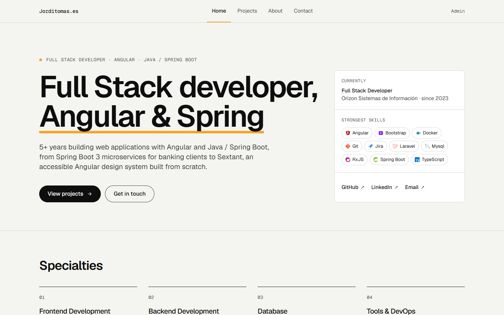
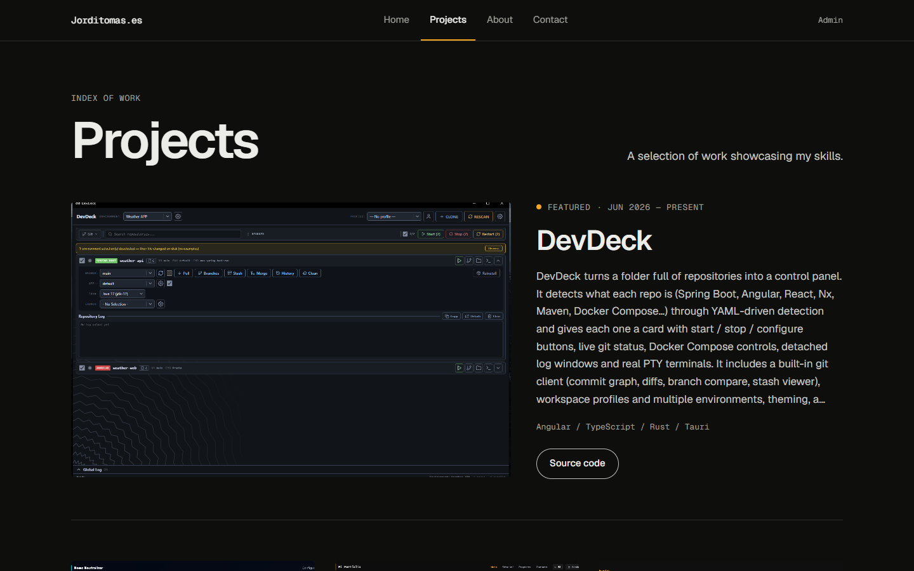
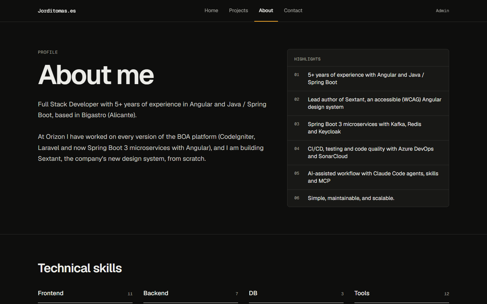
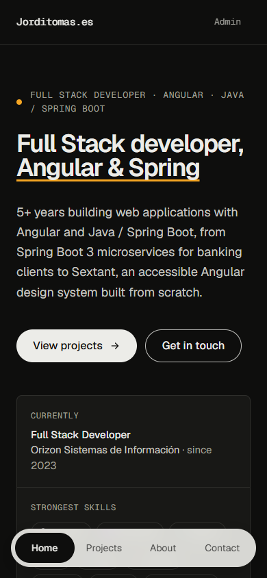
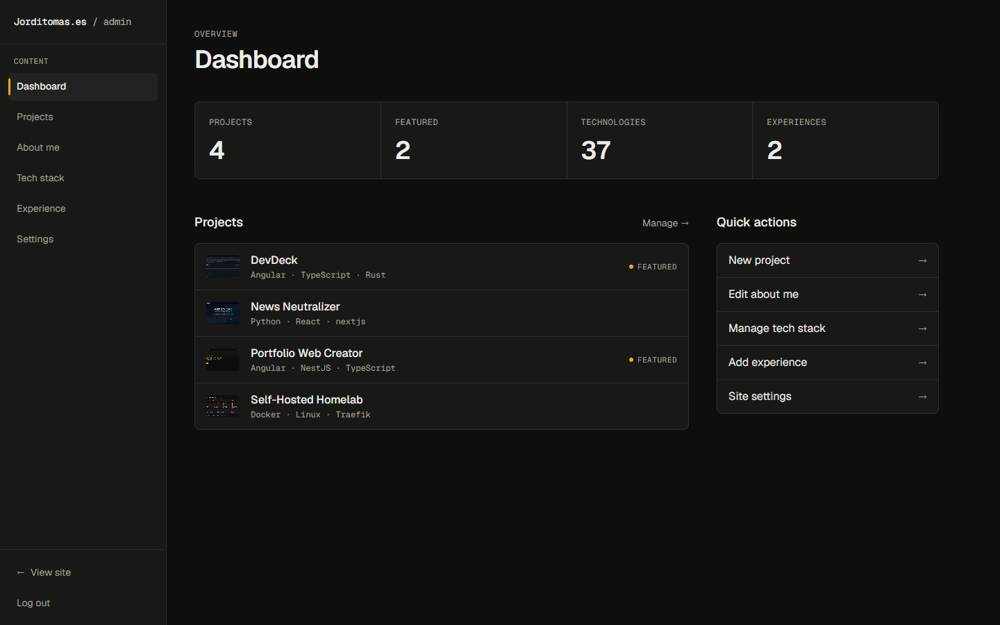
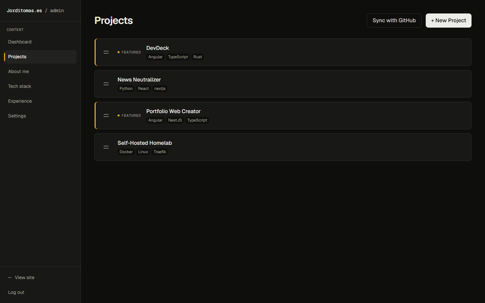
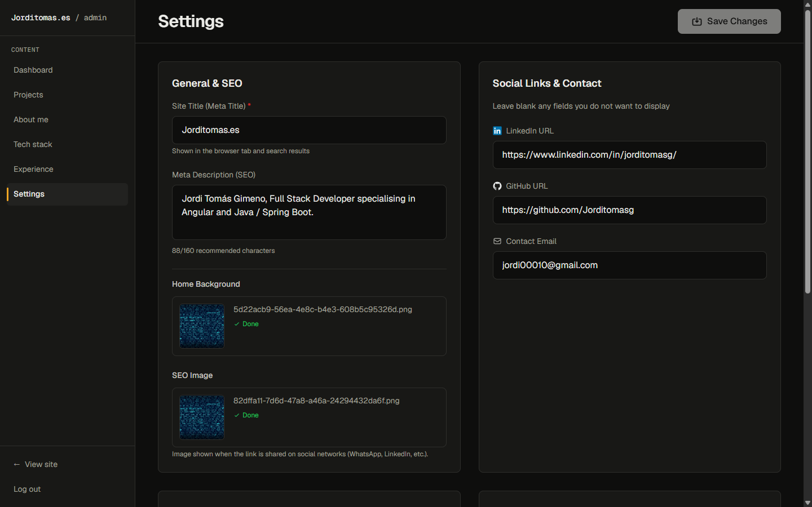

# Portfolio Web Creator

A modern, customizable portfolio website builder with **Angular** (frontend, server-side rendered) and **NestJS** (backend). Features a complete admin panel, SEO out of the box, and dynamic theming.


## 📸 Screenshots

<p align="center">
  <picture>
    <source media="(prefers-color-scheme: dark)" srcset="docs/screenshots/home-dark.png">
    
  </picture>
</p>

<table>
  <tr>
    <td width="50%"><br><sub><b>Projects</b>: featured work with images, tech stack and links</sub></td>
    <td width="50%"><br><sub><b>About</b>: bio, highlights and technical skills</sub></td>
  </tr>
  <tr>
    <td width="50%"><br><sub><b>Light mode</b>: follows the visitor's system preference</sub></td>
    <td width="50%" align="center"><br><sub><b>Mobile</b>: floating bottom navigation</sub></td>
  </tr>
</table>

### Admin panel

<table>
  <tr>
    <td width="50%"><br><sub><b>Dashboard</b>: content overview and quick actions</sub></td>
    <td width="50%"><br><sub><b>Projects</b>: drag to reorder, feature, or sync with GitHub</sub></td>
  </tr>
  <tr>
    <td colspan="2"><br><sub><b>Settings</b>: site title, meta description, SEO image, social links, favicon and accent color</sub></td>
  </tr>
</table>

## ✨ Features

### Frontend
- **Angular 21** with zoneless change detection
- **Server-side rendering** (`@angular/ssr`): crawlers and link previews get fully rendered HTML
- **Tailwind CSS** for modern, responsive styling
- **Automatic dark mode** following the visitor's `prefers-color-scheme`
- **Dynamic theming**: customizable accent color and favicon
- **Visitor analytics**: optional self-hosted [Umami](https://umami.is) (countries, cities, referrers, devices)

### Backend
- **NestJS** with TypeORM
- **PostgreSQL** for data storage
- **JWT authentication** for admin access
- **RESTful API** with validation
- **Dynamic favicon** served as SVG from the saved settings

### Admin Panel
- **Dashboard** with content overview
- **Projects**: full CRUD, plus **Sync with GitHub** to import your public repos
- **Experience**: work history timeline
- **Technologies**: centralized icons (auto-fetched from DevIcon or custom URL), categories and a 0-5 level (0 hides it)
- **About & Hero editor**: bio, highlights and hero section
- **Settings**:
  - Site title and meta description
  - Home background and SEO image (used for link previews)
  - Social links (LinkedIn, GitHub, Email)
  - Favicon (6 preset icons) and accent color
  - Toggle admin link in navigation
  - Umami analytics

## 🔍 SEO

Public pages (`/`, `/projects`, `/about`, `/contact`) are rendered on the server, so search engines and social
networks receive the real content without running JavaScript. Every page ships:

- `<title>` and `<meta name="description">` from **Settings**
- Open Graph (`og:title`, `og:description`, `og:image`, `og:url`, `og:type`) and `twitter:card`
- `<link rel="canonical">` with the public URL of the page
- `<link rel="icon">` pointing to `/api/favicon.svg`, generated from the selected favicon and accent color

The admin panel (`/admin/**`) is rendered in the browser only. Data fetched during server rendering is handed over to
the browser, so the API is not called twice on page load.

## 🏗️ Architecture

```
Browser / crawler ──► Angular SSR server (:4200) ──► /api, /uploads ──► NestJS (:3000) ──► PostgreSQL
```

- The SSR server renders pages and proxies `/api` and `/uploads` to the backend, so exposing **port 4200** is enough.
  A reverse proxy (Traefik, nginx) may also route `/api` and `/uploads` straight to the backend.
- During server rendering, API calls go directly to `BACKEND_URL` instead of looping through the public domain.

## 🚀 Installation

### Method 1: Clone Repository (Recommended for Development)

1. **Clone and navigate**
```bash
git clone https://github.com/Jorditomasg/portfolio-web-creator.git
cd portfolio-web-creator
```

2. **Configure environment** (optional, has defaults)
```bash
cp .env.example .env
# Edit .env if you want custom credentials
```

3. **Start with Docker Compose**
```bash
docker compose up -d
```

4. **Access the application**
- Frontend: http://localhost:4200
- Admin Panel: http://localhost:4200/admin/login
- Default login: `admin` / `admin123`

---

### Method 2: Docker Hub (single container)

Perfect for quick deployment: one image runs the backend and the SSR server.

1. **Create a directory**
```bash
mkdir portfolio && cd portfolio
```

2. **Create `docker-compose.yml`**

Copy and paste this content into a new `docker-compose.yml` file:

```yaml
services:
  db:
    image: postgres:16-alpine
    container_name: portfolio-db
    environment:
      POSTGRES_USER: portfolio_user
      POSTGRES_PASSWORD: portfolio_pass
      POSTGRES_DB: portfolio_db
    volumes:
      - postgres_data:/var/lib/postgresql/data
    restart: unless-stopped

  app:
    image: jorditomasg/portfolio-web-creator:latest
    container_name: portfolio-app
    environment:
      # Database Configuration
      - POSTGRES_USER=portfolio_user
      - POSTGRES_PASSWORD=portfolio_pass
      - POSTGRES_DB=portfolio_db
      
      # App Configuration (Generate secret with: openssl rand -base64 32)
      - JWT_SECRET=change_this_secret_in_production
      - NODE_ENV=production
      - ADMIN_USERNAME=admin
      - ADMIN_EMAIL=admin@example.com
      - ADMIN_PASSWORD=admin123
    depends_on:
      - db
    ports:
      - "4200:4200"
    restart: unless-stopped
    volumes:
      - ./uploads:/app/backend/uploads

volumes:
  postgres_data:
```

3. **Start the application**
```bash
docker compose up -d
```

4. **Access your portfolio**
- Frontend: http://localhost:4200
- Admin Panel: http://localhost:4200/admin/login
- Login: `admin` / `admin123`

> ⚠️ **Security**: Change `JWT_SECRET` and `ADMIN_PASSWORD` for production!

A ready-to-use variant with `.env` support and required secrets lives in [`deploy/`](deploy/README.md).

---

## 🔧 Configuration

| Variable | Description | Default |
|----------|-------------|---------|
| `POSTGRES_USER` | Database username | `portfolio_user` |
| `POSTGRES_PASSWORD` | Database password | Required |
| `POSTGRES_DB` | Database name | `portfolio_db` |
| `JWT_SECRET` | JWT signing secret | Required |
| `NODE_ENV` | Environment mode | `development` |
| `ADMIN_USERNAME` | Initial admin username | `admin` |
| `ADMIN_EMAIL` | Initial admin email | `admin@example.com` |
| `ADMIN_PASSWORD` | Initial admin password | `admin123` |
| `GITHUB_TOKEN` | Optional token for **Sync with GitHub** (without it GitHub allows 60 requests/hour) | — |
| `BACKEND_URL` | Backend address used by the SSR server (proxy and server-side API calls) | `http://localhost:3000` |
| `PORT` | Port of the SSR server | `4200` |

`BACKEND_URL` and `PORT` are already set in the Docker images; change them only for custom setups.

### Settings (Admin Panel)

| Setting | Description |
|---------|-------------|
| **Site Title** | Browser tab, footer, `<title>` and `og:title` |
| **Meta Description** | `<meta name="description">` and `og:description` (max 160 chars) |
| **Home Background** | Background image of the home hero |
| **SEO Image** | `og:image` shown in link previews |
| **LinkedIn/GitHub/Email** | Optional social links |
| **Favicon Type** | terminal, code, rocket, star, briefcase, user |
| **Accent Color** | Primary color for buttons, highlights and the favicon |
| **Show Admin Link** | Toggle "Admin" in navigation menu |
| **Umami URL / Website ID** | Enables the analytics tracker. Leave empty to disable |

### Analytics (Umami)

`docker-compose.yml` ships an `umami` service (own database, port 3001). Open it, change the default
`admin` / `umami` password, add a website, then paste the Umami public URL and the Website ID in
**Admin → Settings → Analytics**. To exclude your own visits run `localStorage.setItem('umami.disabled', 1)`
in the browser console on your site.

## 🔒 Security Best Practices

Before deploying to production:

1. **Change all default passwords** in `.env`
2. **Generate a secure JWT secret**: `openssl rand -hex 32`
3. **Never commit `.env`** to version control
4. **Use HTTPS** in production
5. **Disable admin link** in settings unless needed

## 🎨 Customization

### Favicon Options

Served at `/api/favicon.svg` in the selected accent color.

| Type | Description |
|------|-------------|
| `terminal` | Terminal/CLI icon (default) |
| `code` | Code brackets `</>` |
| `rocket` | Rocket icon |
| `star` | Star icon |
| `briefcase` | Briefcase icon |
| `user` | User profile icon |

### Accent Colors

Default palette: Yellow (#F5A623), Green, Blue, Purple, Pink, Red

Or use the custom color picker in Settings.

### Technology Icons

Icons are managed centrally via the **Technologies** page in the Admin Panel.
- **Auto-detection**: When adding a technology, the system attempts to auto-fetch the icon from [DevIcon](https://devicon.dev/).
- **Smart Tags**: In the Projects editor, typing a technology name (e.g., "Angular") will auto-suggest existing technologies and display their correctly associated icons.
- **Custom Icons**: You can manually provide any image URL for a technology if the auto-detection fails.

## 🛠️ Tech Requirements

- **Docker** for the methods above
- **Node.js 24** to run or test the apps outside Docker (`npm test` in `backend/` and `frontend/`)

## 📝 License

MIT License - see [LICENSE](LICENSE) for details.


---

Made with ❤️ using Angular & NestJS
